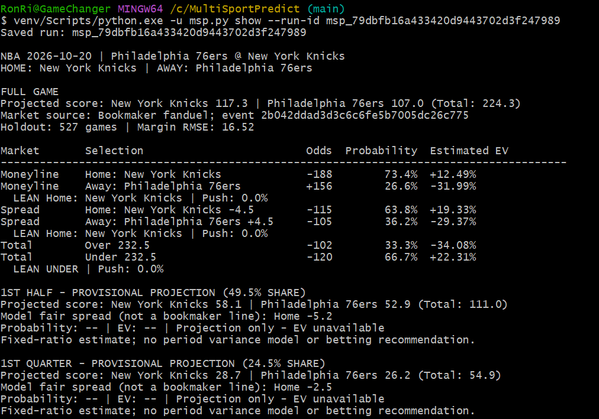
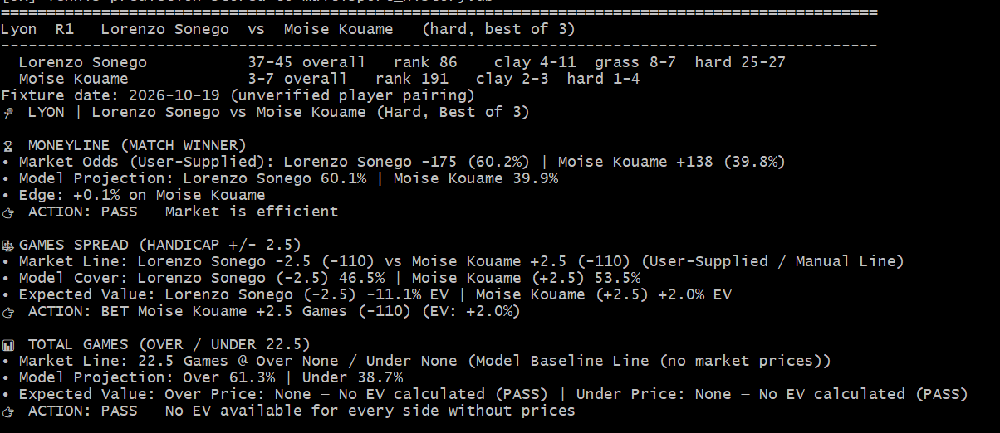
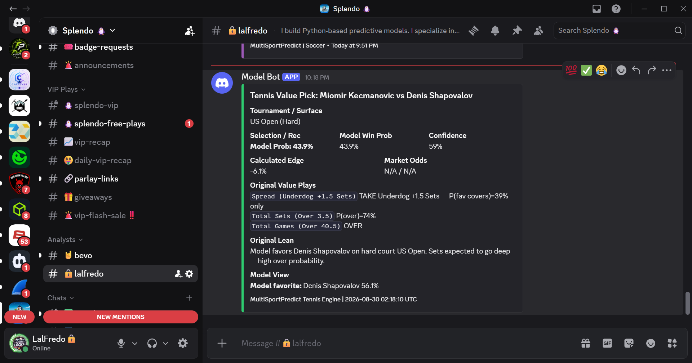
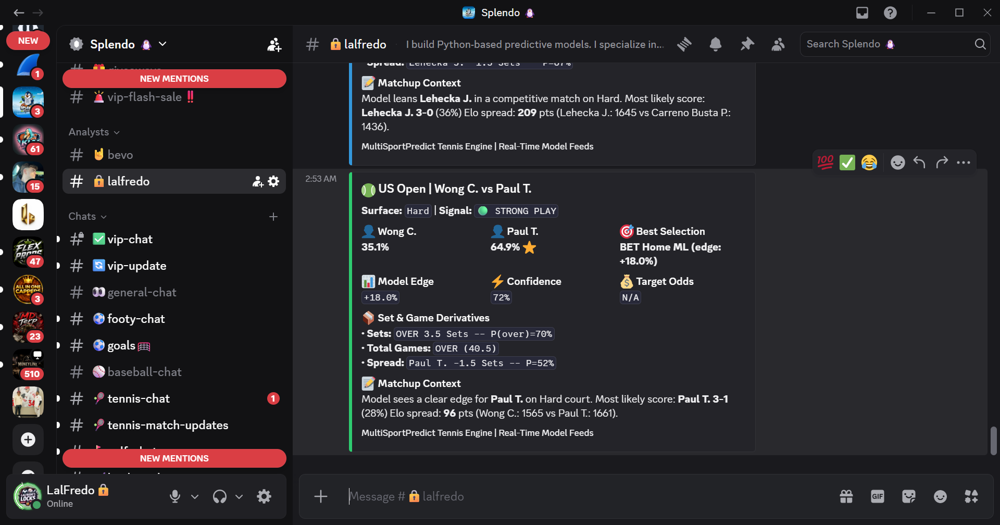
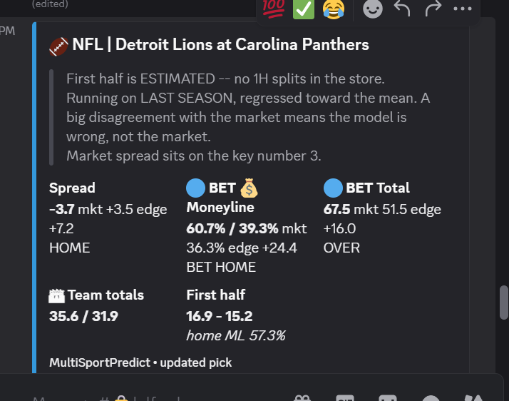
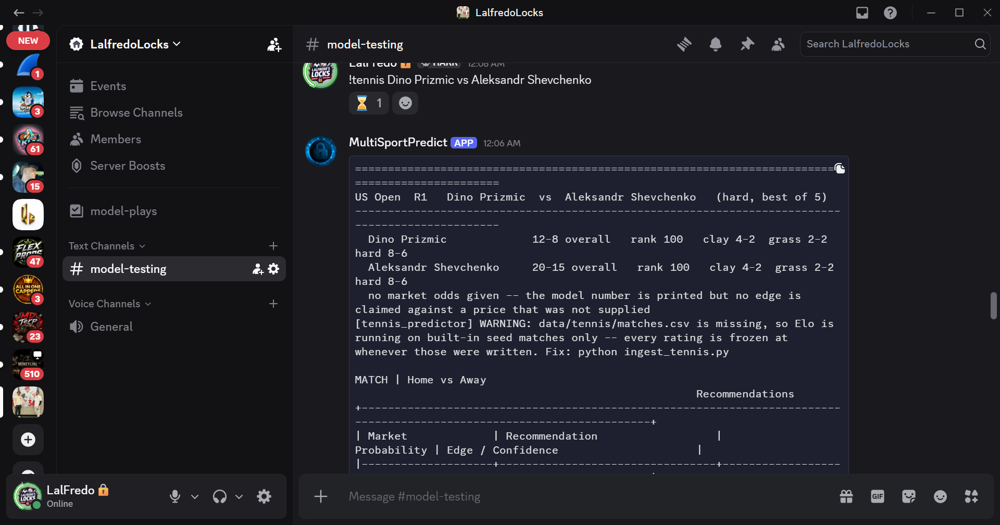
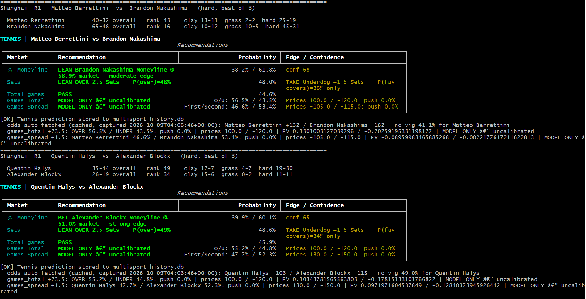
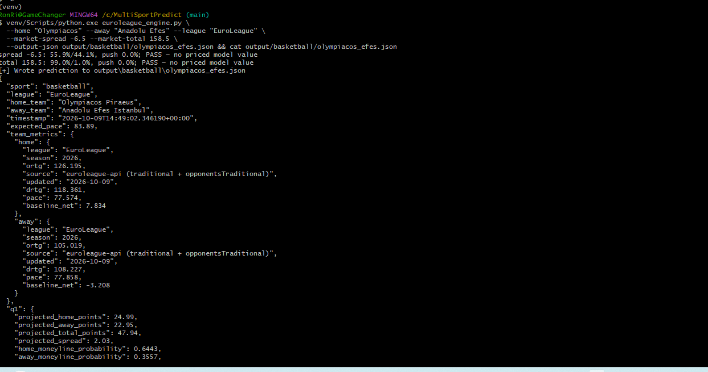
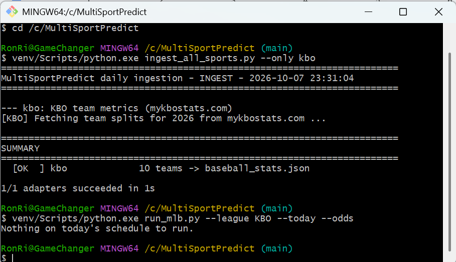
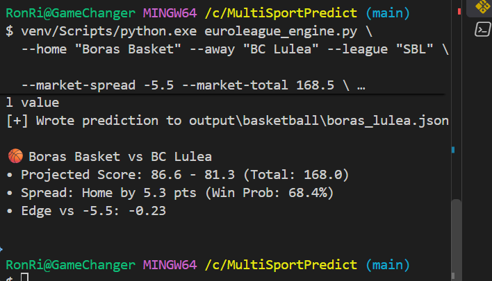

# MultiSportPredict evidence

This section contains historical screenshots of actual project output, copied unchanged from the owner's local screenshot collection. Dates below come from screenshot filenames; displayed timestamps provide additional context where visible. These captures illustrate workflows, not verified betting performance. Existing images under `output/command_guides_20261011/` and `output/table_tennis/` are rendered documentation previews, not result evidence.

## Current review output

### NBA: Knicks–Sixers readable saved review — October 20, 2026

Shows saved run `msp_79dbfb16a433420d9443702d3f247989`: named Home/Away selections, original prices, rounded estimated EV, holdout diagnostics, and provisional 1H/1Q score means. The period sections explicitly contain no probabilities, EV or betting recommendations. This is a review of a saved forecast, not a confirmed final or wager result. See [NBA review behavior and assumptions](../NBA_REVIEW.md).

### Tennis: manual lines and an unverified pairing — October 20, 2026

Shows user-supplied moneyline/handicap prices and a baseline total without market prices. The terminal explicitly labels the fixture date October 19 and the player pairing **unverified**. It illustrates pricing output and an unpriced-total PASS; it does not verify the matchup, supplied prices, displayed model probabilities or recommendation quality. Capture date and displayed fixture date are intentionally recorded separately.

## Historical Discord delivery and diagnostics

### Tennis: Kecmanovic–Shapovalov card — August 29, 2026

Illustrates delivery of a tennis card with surface, model probabilities and derivative text. Market odds display `N/A / N/A`; the capture does not substantiate a priced edge. The screenshot filename is August 29, while the visible footer is August 30 at 02:18:10 UTC. It is not a graded-result or wager-placement record.

### Tennis: Wong–Paul legacy card — August 30, 2026

Shows a legacy recommendation card and its displayed model figures. Target odds are unavailable, so the shown positive-edge label cannot be independently supported from this image. Older selection/side labeling is preserved as captured; use this as delivery/interface history, not a validated pricing or accuracy claim.

### NFL: Lions at Panthers — October 4, 2026

Shows delivery formatting for side, moneyline, total, team totals and first-half estimates. The visible disclaimer states that first-half splits are estimated and inputs come from the prior season. The displayed edge figures are historical model output, not confirmed calibrated edges or settled profits; this is not a current-season accuracy example.

### Tennis: missing history and absent market prices — August 30, 2026

The Discord test output explicitly warns that match history is missing and Elo is using built-in seed matches. It also states that no price edge is claimed without supplied odds. This is a historical diagnostic example, not evidence of adequate training data or current production behavior.

## Earlier terminal captures

### Tennis: market comparison — October 9, 2026

Shows Berrettini–Nakashima and Halys–Blockx output with model probabilities, moneyline prices, no-vig market references and displayed game-market EV. Several rows are explicitly labeled model-only/uncalibrated. This demonstrates the historical comparison interface; it does not validate those probabilities, EV estimates, fixture identities or final outcomes. Older presentation/encoding issues are preserved in the original capture.

### EuroLeague: an unpriced market remains a pass — October 9, 2026

Shows Olympiacos–Anadolu Efes output, source-tagged team metrics and `PASS — no priced model value` for spread/total markets. It illustrates why a model probability alone is insufficient to establish value at an offered price. It is not proof of universal guard coverage or calibrated accuracy.

### KBO: data refresh and an empty slate — October 7, 2026

The terminal reports ingestion of ten KBO teams, followed by `Nothing on today's schedule to run.` This documents source ingestion and the displayed slate outcome at that time. It is not evidence that a pick was issued, a wager was placed or a result was graded.

### Basketball: manual-input projection — October 9, 2026

Shows a Boras Basket–BC Lulea projection, a supplied spread/total and a saved JSON path. A companion capture from the same session shows explicit team-rating/pace overrides, so this is classified as a manual-input demonstration. The displayed point edge is not an EV percentage; the screenshot does not verify input provenance, fixture status, odds or a profitable outcome.

## Categories

| Folder | What belongs here | What it demonstrates |
|---|---|---|
| `picks/` | Full saved match/slate reviews and recommendation cards | The selection, market, price and model output at that time |
| `pricing/` | Timestamped odds comparisons, line discrepancies and EV displays | The market price used to evaluate value |
| `delivery/` | Discord cards and delivery confirmations | A recommendation was delivered; this does not establish a wager |
| `grading/` | Confirmed finals and corresponding settled selections | How a specific stored pick was graded |
| `performance/` | Dated record summaries, ROI reports and drawdown charts | Aggregate results with their sample, period and price coverage |
| `validation/` | Data/fixture refusals, test results and source diagnostics | Reliability checks and visible handling of unavailable data |

Conceptual diagrams live separately under [methodology illustrations](../illustrations/methodology/README.md). They explain price discrepancies, EV arithmetic and fractional sizing; they are not empirical evidence.

Create additional category folders when evidence is added. Use descriptive, dated filenames. Historical delivery captures are now included; verified grading and performance screenshots are still needed. The root README links here for the complete collection. [The October 20 image manifest](screenshots_2026-10-20.json) records the nine supplied source filenames, repository destinations and SHA-256 hashes of unchanged copies.

## Captions and context

Each image entry should state its capture date, sport/market, the feature demonstrated, and any important limitation. Link a saved run or supporting report when available. Distinguish estimated EV, model selections, delivered recommendations and actual wagers. Label historical captures when the interface or record has changed.

Keep source images unchanged. Do not edit odds, dates, results or displayed figures. Review screenshots for credentials and private information before including them in a public commit. A dated screenshot illustrates a result; it does not replace the underlying record or establish long-term accuracy.

Performance evidence must retain the qualifications in [the historical performance disclosure](../PERFORMANCE_2026-10-19.md), including recorded-price coverage and the exclusion of unresolved historical outcomes during cleanup.
