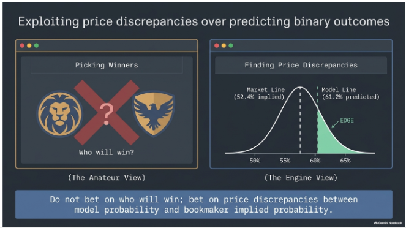
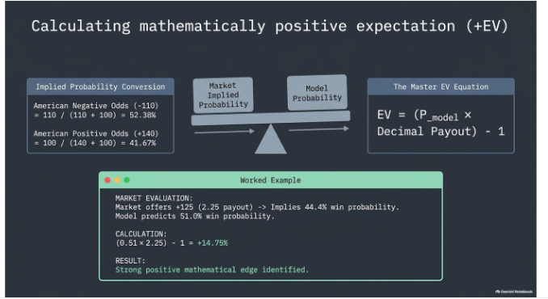
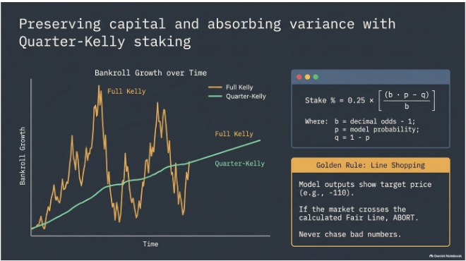

# Methodology illustrations

These user-supplied graphics explain the project's value-handicapping philosophy. They are conceptual illustrations, not measured market data, backtests, bankroll histories or performance evidence. Original imagery and attribution marks are preserved unchanged.

## Price discrepancies rather than binary winner selection

Illustrates comparing an estimated probability with the probability implied by an offered price. The plotted values and shaded area are explanatory examples, not a verified model edge or an observed probability distribution. A probability difference is not itself the same quantity as expected return.

## Positive expected value: hypothetical arithmetic

The worked example assumes a 51% win probability and decimal odds of 2.25: `0.51 × 2.25 − 1 = +14.75%`. This arithmetic assumes a binary win/loss market with no push; actual push-capable markets must account for pushes. The probability is hypothetical and does not establish model calibration or attainable returns.

## Fractional Kelly and line shopping

Explains fractional sizing and price discipline. The drawn bankroll paths are illustrative, not actual model results or a simulation report; quarter-Kelly does not guarantee smooth growth or preservation of capital. The graphic is not a claim that every runner currently applies this sizing policy or implements an automatic fair-line abort.

See the [workflow evidence gallery](../../evidence/README.md) for actual terminal/Discord captures, and the [performance disclosure](../../PERFORMANCE_2026-10-19.md) for the retained historical record and its limitations.
